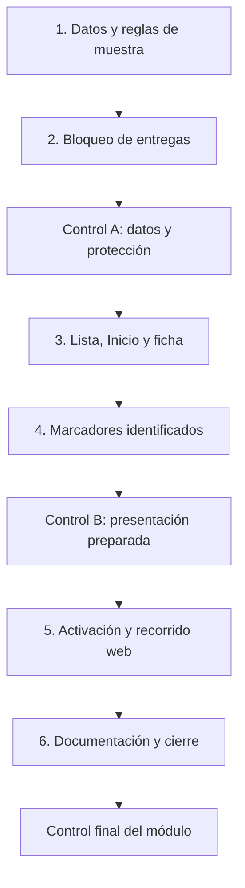

# Plan: Universidad de Pilar como punto de ejemplo

Módulo activo: `alta-universidad`.
Especificación [aprobada](../SPEC-alta-universidad.md) el 14 de octubre de 2026.
Estado: plan y tareas aprobados por el usuario («Apruebo todo») el 14 de octubre de 2026; módulo implementado y verificado; evidencia y límites en `tasks/validation.md`.

El módulo anterior está completado. Sus artefactos se preservan en [plan-cierre-flujos.md](plan-cierre-flujos.md) y [todo-cierre-flujos.md](todo-cierre-flujos.md), con evidencia en [validation.md](validation.md). No había tareas anteriores sin completar al preparar este plan.

## Resultado esperado

Universidad de Pilar aparecerá como muestra en Inicio, Puntos verdes y su ficha únicamente cuando una consulta exitosa no encuentre puntos reales publicados. Se mostrarán dirección, lunes a sábado de 10:00 a 20:00 y todas las categorías cargadas. La muestra será reconocible y no permitirá entregas, fotos ni códigos reales. Cafe del Pellegrini conserva su módulo posterior.

## Decisiones técnicas

1. Conservar el modelo actual de coordenadas y añadir una distinción opcional `demo` a `GreenPoint`. Los registros reales no tendrán esa marca. ID estable de muestra separado de UUID persistidos; comprobación compartida de elegibilidad para entregas que también rechace IDs de ejemplo.
2. Construir la muestra con las categorías cargadas, sin UUID fijos ni mutación de los datos recibidos. Seis intervalos de 600 a 1200 minutos para días 1 a 6; zona argentina; sin teléfono ni retiros. No inventar categorías si el catálogo está vacío.
3. Seleccionar la muestra sólo en la resolución exitosa de `DiscoveryProvider`, después de obtener puntos y categorías. Conservar cancelación, revisión y aislamiento de sesión del provider, servicio Supabase, paginación y filtros. Carga/error nunca devuelven muestras.
4. Preparar los avisos y el bloqueo antes de activar el ejemplo. Lista, Inicio, ficha y marcador lo identificarán. El estado horario será explícitamente de ejemplo; no prometerá recepción real.
5. `new-delivery` excluirá muestras del selector y rechazará el ID de ejemplo por URL. No montará `DeliveryForm` ni consultará tarifas para ese ID; permitirá volver a Puntos verdes. Se conserva el formulario para puntos reales.
6. Reutilizar `PointRow`, `ScreenHeader`, `ActionButton`, componentes de feedback y tema. No hay cambios globales de diseño, migraciones, dependencias nuevas, cuentas, roles, tarifas, saldo ni escrituras remotas.

## Ubicación verificada

El 14 de octubre de 2026 se comprobó que [Ingresantes, web oficial de la universidad](https://unpilar.edu.ar/INGRESANTES) identifica la Sede Pellegrini en Honorio Pueyrredón, Ruta 25 Nº1837, Villa Rosa, e incluye este [mapa de cómo llegar](https://www.google.com/maps/d/embed?mid=1NzXfC1uBwyKIpSl6huZwyyOmZTZdq_g&ehbc=2E312F).

El [KML público del mismo mapa](https://www.google.com/maps/d/kml?mid=1NzXfC1uBwyKIpSl6huZwyyOmZTZdq_g&forcekml=1) contiene el marcador `SEDE PELLEGRINI`, descripción `UNIVERSIDAD NACIONAL DE PILAR`, coordenadas KML `-58.892156,-34.4378787,0` (longitud, latitud, altitud). Usar **latitud -34.4378787, longitud -58.892156**. Es la sede señalada por ese mapa, no una puerta de recepción RAEE confirmada ni una precisión física medida. No usar las paradas de transporte ni otras sedes.

La comprobación satisface el requisito de fuente identificable para el marcador; no acredita un servicio RAEE real allí. El horario sigue siendo el indicado por el usuario.

## Dependencias y orden



Ejecución secuencial por compartir modelo, provider y superficies. No se necesitan agentes paralelos. Cada tarea tiene hasta cinco archivos de implementación/pruebas; las actualizaciones rutinarias de seguimiento acompañan su ejecución. Los controles se realizan cada dos tareas. Resolver defectos y verificar lo afectado antes de avanzar; no repetir suites SQL sin cambios de backend. Las correcciones rutinarias dentro del plan aprobado no requieren nuevas autorizaciones.

## Comandos de verificación

```powershell
npx tsc --noEmit
npm run lint
node --test tests/*.test.mjs
npx expo export --platform web --output-dir dist-closure
git diff --check
```

Desarrollo y prueba web en terminales separadas:

```powershell
npx expo start --web --port 8083 --offline
```

```powershell
$env:PLAYWRIGHT_MODULE_DIR = 'C:/Users/walte/.cache/codex-runtimes/codex-primary-runtime/dependencies/node/node_modules/playwright'
$env:TEST_APP_URL = 'http://localhost:8083'
node --test tests/integration/point-examples.test.mjs
```

La nueva prueba usará consultas públicas interceptadas para estados del catálogo y una cuenta temporal exclusivamente en Supabase local si requiere sesión para verificar la URL de entrega. Comprobar el entorno antes, limpiar por ID, no imprimir secretos ni leer tokens del navegador. Cualquier override local temporal se retira al finalizar. No se usan cuentas remotas reales.

## Riesgos y respuesta

| Riesgo                                                              | Respuesta                                                                                                                       |
| ------------------------------------------------------------------- | ------------------------------------------------------------------------------------------------------------------------------- |
| Muestra durante carga/error o al filtrar datos reales               | Activar sólo ante éxito vacío original; probar carga, error/reintento, catálogo real y búsqueda sin coincidencias por separado. |
| URL directa inicia una entrega de ejemplo                           | Guard previo al formulario, exclusión del selector y prueba de ausencia de tarifas, uploads y RPC de creación.                  |
| URL de muestra permanece al aparecer puntos reales                  | Estado no disponible sin operaciones; no reconstruir muestras fuera del catálogo vigente.                                       |
| Estado abierto parece prometer recepción                            | Aviso visible y horario explícitamente de ejemplo.                                                                              |
| Categorías cambian entre entornos                                   | Consumir la carga vigente, sin UUID fijos; probar también categorías vacías.                                                    |
| Coordenadas de la sede se interpretan como servicio RAEE confirmado | Documentar origen y carácter de muestra.                                                                                        |
| Dirección/categorías largas afectan móvil                           | Revisar 390 y 1280 px, texto aumentado, foco y desbordes.                                                                       |

## Condición de cierre y decisión pendiente

Criterios de la especificación comprobados, regresiones aprobadas, revisión visual realizada y evidencia registrada. Sin despliegue ni conversión a organización operativa. La iniciativa conserva pendientes `alta-cafe`, `validacion-cierre` y las limitaciones documentadas.

Plan y desglose aprobados; ejecución autorizada. No quedan preguntas de datos para Universidad de Pilar.
