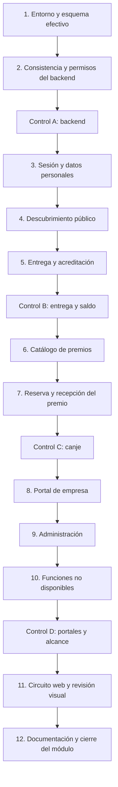

# Plan de implementación: cierre de los flujos actuales

Módulo: `cierre-flujos`.
Especificación aprobada: [SPEC-cierre-flujos.md](../SPEC-cierre-flujos.md).
Mapa completo: [CAPABILITY-MAP-cierre-app.md](../CAPABILITY-MAP-cierre-app.md).
Estado: plan aprobado el 13 de octubre de 2026; módulo verificado el 14 de octubre de 2026. No se crearon las altas ni se publicó la app.

## Resultado esperado

Comprobar y corregir los recorridos ya implementados de ciudadano, empresa y admin, de modo que una entrega confirmada acredite puntos globales y un canje los descuente una sola vez. Preservar permisos, información existente y el diseño compartido. Preparar una base comprobada para las altas solicitadas.

El trabajo es una revisión con correcciones acotadas: cada recorrido que ya cumpla sus criterios se conserva y se documenta su verificación. No se reescriben componentes ni se agregan dependencias por anticipación.

## Alcance vigente y pasos posteriores

Este plan implementa únicamente la especificación aprobada `cierre-flujos`. Las altas se conservan en el mapa como compromisos posteriores y no se consideran realizadas al cerrar este módulo:

| Módulo posterior    | Datos vigentes                                                                                                    | Pendiente                                                                                                             |
| ------------------- | ----------------------------------------------------------------------------------------------------------------- | --------------------------------------------------------------------------------------------------------------------- |
| `alta-universidad`  | Universidad de Pilar; Av. Honorio Pueyrredón, Ruta 25 Nº1837, Villa Rosa, Provincia de Buenos Aires; 10:00–20:00. | Especificación de muestra; lunes a sábado, todas las categorías, sin cuenta ni operaciones reales. Tarifas diferidas. |
| `alta-cafe`         | Cafe del Pellegrini; misma dirección; Un café por 100 puntos globales.                                            | Especificación de muestra; sin cuenta, canjes reales, horario o stock inventados.                                     |
| `validacion-cierre` | Ejemplos universidad y café; revisión final.                                                                      | Depende de ambas muestras; conserva evidencia del circuito operativo local.                                           |

En este módulo el circuito entre organizaciones se verifica con fixtures identificadas, no con datos comerciales inventados. “App terminada” no se declarará mientras las altas u otras condiciones necesarias sigan pendientes.

## Decisiones técnicas

1. Mantener Expo SDK 57, Expo Router, servicios actuales y los modelos existentes. Leer la documentación versionada pertinente antes de cualquier modificación de código Expo.
2. Conservar RPC transaccionales como autoridad de permisos, saldo y estado. No introducir escrituras directas del cliente sobre movimientos o canjes.
3. Mantener `points_transactions` como procedencia de créditos y `reward_redemptions` como débitos del saldo global. El XP es independiente y no se gasta.
4. Mantener los contratos `reward_command` (`save`, `reserve`, `get`, `lookup`, `confirm`), `delivery_command` y `portal_command`. Si un defecto requiere cambiar contrato/esquema, registrar primero el ajuste en la especificación y preparar una migración mínima compatible. No editar una migración aplicada para simular que el remoto ya cambió.
5. Conservar idempotencia: reintentar una reserva reutiliza su identificador; confirmar de nuevo una operación devuelve el resultado persistido sin otra acreditación o débito.
6. Separar pruebas locales, SQL, concurrencia, backend remoto, navegador y dispositivos físicos en el informe. Las pruebas SQL secuenciales existentes no demuestran concurrencia.
7. Reutilizar `ScreenHeader`, `ActionButton`, `RewardsUI`, `PortalUI`, `AdminPage` y `@/theme`. No cambiar reglas compartidas; si fuese necesario un cambio aprobado, sincronizar `DESIGN.md` y `.impeccable/design.json`.

## Dependencias y orden

Las tareas detalladas, aceptación y comandos están en [todo.md](todo.md). El informe de ejecución se creará en `tasks/validation.md` al comenzar, para conservar evidencia y pendientes sin mezclar pruebas pasadas con nuevas.

## Forma de ejecución

- Ejecutar en el orden propuesto, sin subagentes. Las comprobaciones independientes de TypeScript, lint y tests pueden ejecutarse simultáneamente; escrituras, migraciones y pruebas que comparten fixtures son secuenciales.
- En cada tarea, reproducir el fallo antes de corregirlo cuando exista. Agregar una regresión de comportamiento donde sea útil; no crear tests para simples textos o cambios visuales reversibles.
- Los archivos del desglose son candidatos a intervención, no un mandato de modificarlos. Si una corrección supera aproximadamente cinco archivos, dividirla en subtareas antes de comenzar.
- Después de cada bloque, registrar qué pasó, qué falló y qué resta. Una vez autorizado el plan, los controles intermedios sirven para informar y verificar; se pide otra decisión sólo si surge una ampliación de alcance o una aprobación realmente necesaria.
- No repetir suites completas después de cada cambio si no hay evidencia que lo justifique. Usar la prueba enfocada, checks pertinentes y una regresión completa al final.

## Verificación del backend

Primero identificar el proyecto al que apunta la app y contrastar de forma no destructiva tablas, RPC, RLS y migraciones efectivas. La documentación histórica no acredita el estado remoto actual.

Las suites SQL existentes crean fixtures dentro de una transacción y terminan con rollback. Se ejecutan en el entorno local con esquema base completo. Para concurrencia se necesitan dos conexiones con transacciones independientes: usar un entorno local aislado, fixtures comprometidas sólo allí, tokens de prueba por rol y limpieza limitada a sus identificadores. Comprobar al menos dos reservas simultáneas contra saldo para una sola reserva, dos ciudadanos contra la última unidad y dos reintentos simultáneos con el mismo request ID.

Los recorridos web usan datos/cuentas de prueba identificadas en un entorno apto. Los emails se inspeccionan en el receptor local de pruebas cuando esté disponible; no se envían invitaciones a terceros. El backend remoto se consulta para verificar su configuración y sus lecturas públicas; no se aplican cambios de esquema o de infraestructura como parte de una comprobación exploratoria.

Si falta el esquema base, acceso al proyecto o una herramienta necesaria, registrar el bloqueo concreto y continuar las comprobaciones independientes. Un módulo con criterios críticos no verificados se entrega como pendiente de validación, nunca como terminado.

## Riesgos y respuesta

| Riesgo                                                   | Consecuencia                                                               | Respuesta                                                                                                                              |
| -------------------------------------------------------- | -------------------------------------------------------------------------- | -------------------------------------------------------------------------------------------------------------------------------------- |
| Migraciones base ausentes del repositorio                | No se puede reconstruir el esquema sólo con los tres archivos versionados. | Inventariar lo disponible en la tarea 1; reutilizar un entorno completo, sin resetear el remoto ni inventar las migraciones faltantes. |
| Backend distinto del código local                        | Tablas/RPC o permisos faltantes al abrir la app.                           | Comparar esquema efectivo y contratos antes de corregir pantallas; documentar el cambio mínimo si hace falta.                          |
| Concurrencia no cubierta por tests secuenciales          | Saldo o stock inconsistentes bajo solicitudes simultáneas.                 | Probar desde conexiones distintas y verificar saldo, reservas y stock persistidos.                                                     |
| Respuestas tardías después de cambiar de cuenta          | Información personal de otra sesión visible.                               | Verificar aislamiento por usuario, cancelación/invalidez de cargas y actualización de saldo.                                           |
| Contacto o términos sin configurar                       | La publicación operativa queda incompleta.                                 | Mantener estados honestos y registrar datos faltantes; no inventar correo ni texto legal.                                              |
| Herramientas web o credenciales de prueba no disponibles | Recorridos y revisión visual incompletos.                                  | Registrar exactamente qué no se pudo probar; continuar estática y lógica sin declarar equivalencia.                                    |
| Prueba web confundida con prueba nativa                  | Cámara, permisos o selección de archivos sin comprobación física.          | Reportar por separado; Android/iOS físicos permanecen pendientes hasta que se prueben.                                                 |
| Fixtures contaminan datos reales                         | Movimientos o roles de prueba persisten en producción.                     | Preferir local aislado, rollback donde corresponda y limpieza por IDs; no tocar saldos reales ni usuarios existentes.                  |

## Condición de cierre

Se cierra `cierre-flujos` cuando se cumple la especificación y hay evidencia de sus invariantes, pruebas pertinentes, revisión visual de lo afectado y documentación actualizada. Deben quedar explícitos los resultados no ejecutados y los requisitos externos pendientes.

Las altas solicitadas y la tarifa universitaria conservan sus propios estados. Este cierre no constituye despliegue, publicación, merge ni alta de datos reales.

## Decisión pendiente

Plan y desglose aprobados y ejecutados. Las especificaciones de las altas siguen sus propias puertas de revisión; los datos operativos pendientes permanecen en el mapa.
